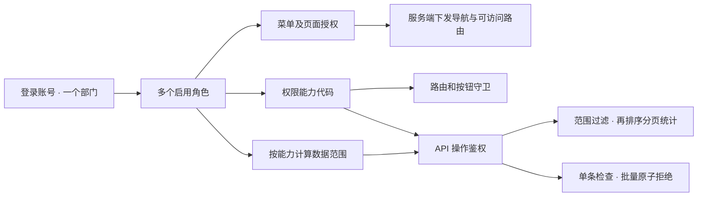

# 系统管理与统一授权

本模块对应 Issue #20。登录账号、角色、权限目录、动态导航及部门数据范围共同构成一条授权链，管理页面使用这条链；业务用户 CRUD 用于验证可见数据和实际写操作是否一致。

## 模型与执行链

- 登录用户是认证主体，与 `/users` 的业务用户示例分开。账号归属一个部门，可分配多个角色。
- 每个角色配置能力代码、菜单和数据范围。停用的角色不参与授权。
- **数据范围按能力代码分别计算**，仅在授予同一能力的角色之间取并集。一个“查看全部”的角色，加上一个“只能修改本人数据”的角色，不会变成“可以修改全部”。会话中的 `dataScope` 仅作总体摘要，API 和行操作使用 `dataScopes[permission]`。
- 系统配置写入（角色、权限、菜单、部门）要求该项写能力的数据范围为全部；账号管理可以按对应账号读/写能力进行部门隔离。
- 超级管理员为内置恢复账号，拥有完整能力与菜单。该账号、超级管理员角色、根部门、工作台和菜单管理恢复入口受到保护。

## 数据范围

| 模式 | 含义 |
| --- | --- |
| `all` | 全部数据 |
| `department` | 当前账号所属部门 |
| `descendants` | 当前账号所属部门及所有下级部门 |
| `self` | `createdBy` 为当前账号；账号记录以账号 ID 判断本人 |
| `custom` | 角色明确指定的部门，不自动包含下级 |

业务记录返回 `departmentId`、`createdBy`，列表附带可展示的 `departmentName`。创建业务用户默认归属操作者部门，API 可显式指定有权写入的部门。编辑时既检查原记录，也检查目标部门，不能通过改部门把记录移出权限边界。业务用户界面展示部门；账号的所属部门在系统管理中配置。

列表在排序、分页和统计前过滤。单条更新/删除逐条校验；批量删除、状态变更和邀请若包含范围外记录，整批拒绝，不能部分成功。创建记录的归属也必须在写范围内。上传要求业务用户写能力及 CSRF；Mock 上传返回当前浏览器对象 URL，不提供跨用户的公共文件下载接口。

审计日志按操作人的所属部门与账号归属记录，查询使用 `audit:read` 的数据范围；系统配置变更追加 `system.changed`，不记录密码、凭据摘要或 CSRF 令牌。

## 动态路由、菜单与按钮

`src/features/system/catalog.ts` 是组件/能力/API 清单，`src/routes` 注册可用组件。服务端配置只能选择清单中的 `routeId`，不能下发代码、组件路径或任意外链。

登录和会话恢复返回 `user.routes`。进入受保护页面时先恢复会话，再检查服务端是否下发该路由，最后执行页面能力守卫。缺少路由授权列表时，受保护页面默认拒绝；工作台为所有已登录账号提供回退入口。后端接入必须实现这些字段，不能只继续返回旧版的三个演示权限。

`GET /api/auth/navigation` 返回当前账号有权访问的导航。侧栏和命令搜索共用这份数据；加载失败显示重试入口，不回退到一份完整管理员静态菜单。

菜单支持目录与页面两层，部门树支持多级。页面需同时满足启用、父目录启用、角色菜单授权及注册页面的查看能力。目录授权包含其页面；也可单独授予页面。菜单的两个状态含义不同：

- **导航隐藏**：从侧栏和命令搜索移除，仍可在有授权时通过直接地址访问。
- **停用**：同时撤销该菜单及子页面的路由访问。

修改菜单不会撤销 API 能力；API 始终根据操作能力和数据范围独立检查。已有按钮复用 `can` / `Permission`，行操作与选择框再按 `users:write` 数据范围校验。动态菜单不能改变注册页面所要求的权限代码。

## 系统 API

统一使用现有 `{data: ...}` / `{error: {code, message}}` 响应和 Cookie 会话。`docs/api.openapi.yaml` 与 Zod 契约共同描述接入边界。

| 接口 | 要求 |
| --- | --- |
| `GET /api/auth/navigation` | 已登录；仅返回已授权导航 |
| `GET /api/system/options` | 至少一个系统资源的读取能力；按资源读取授权及部门范围过滤，不返回账号或凭据 |
| `GET /api/system/{resource}` | `system:{resource}:read`，支持 `page/pageSize/search` |
| `POST /api/system/{resource}` | `system:{resource}:write` 与 CSRF |
| `PUT /api/system/{resource}/{id}` | 同上；更新可写字段，不能修改 ID、类型、保护标记 |
| `DELETE /api/system/{resource}/{id}` | 同上；校验引用关系 |

`resource` 为 `accounts`、`roles`、`permissions`、`menus`、`departments`。API 注册清单将已有业务用户、系统管理和审计操作映射到能力代码；新增真实后端端点时必须显式绑定能力并复用数据范围检查。创建一个权限目录项不会自动创建 API，也不会让任意端点获得授权。

账号响应从不返回密码、摘要或凭据版本。创建账号必须设置初始密码；编辑时密码留空保持原值，填写则重置密码并吊销旧会话。停用后再启用也不能恢复原来的会话。邮箱忽略大小写且唯一。

分配角色及创建、修改角色时，不能授予操作者未持有的能力、更大的按能力数据范围或无权访问的页面；角色变更还须检查全部现有受影响账号。自助账号编辑不允许未经全局账号管理授权调整所属部门。调整现有部门的归属或启用状态时，应检查部门树变化导致的额外权限、数据范围与路由授权，不能借此扩大到操作者原有授权之外。校验也涵盖当前处于停用状态的账号/角色。超级管理员角色只能保留给内置恢复账号。角色、部门和权限代码唯一；删除被引用的配置返回 409，部门循环、任意路由 ID、非法层级和未知字段均拒绝。

## 会话一致性与 Mock 边界

每次 Mock API 请求都会从当前账号、启用角色及部门树重新计算权限，不能信任旧会话中缓存的权限数组。系统写入串行执行，异步处理密码时也不能丢失并发更新；队列开始时重查操作者身份、凭据版本与授权。

保存配置后，客户端刷新会话、查询与路由，撤销的页面和菜单随之失效。账号密码重置、停用或删除会阻止旧 Cookie 继续访问。角色/部门变更按最新关系计算，不需要等待 Cookie 到期。

Mock 账号配置存储在按 Pages 版本路径隔离的当前标签页 sessionStorage 中，刷新可保留管理配置。Mock 仅保存演示密码的 SHA-256 摘要，不返回或记录密码；**这不是生产密码存储方案**。普通生产构建仍排除整个 Mock。真实后端必须提供可信会话存储、成熟的服务端密码验证、会话吊销、数据库事务、授权检查及审计，不能信任浏览器保存的角色或部门字段。

跨标签页真实会话一致性、数据库迁移、生产认证及组织多归属不在本次前端参考实现范围内。业务示例数据和审计仍沿用内存 Mock，刷新会重建种子记录；系统配置持久化不等于业务记录已经持久化。

## 界面与验收

沿用当前 shadcn/ui 与 Tailwind 主题、圆角、表格和对话框，不新增组件库。页面使用“标题与职责说明 → 搜索和统计 → 配置表格 → 分页”的工作流；小屏保持横向表格滚动和限高表单，不增加装饰性首页。

`pnpm test` 验证五种范围、按能力合并、多角色撤权、不可锁死的管理员、部门循环/引用、越权授予、并发写入、旧会话吊销及 API 范围检查。`pnpm test:e2e` 覆盖桌面和手机上的配置界面与新账号真实登录；`pnpm test:demo` 在最终静态产物中再次验证相同闭环。普通生产构建与无 Mock 检查继续执行。

本地审阅入口：`pnpm dev`，使用已有演示管理员进入“系统管理”。合并前不修改线上 Pages；合并后的 Pages 工作流成功并完成在线操作验收，才视为发布完成。回退代码可回到上一提交；若需清理本地演示配置，只删除当前版本的 `react-admin-starter:system-v1:<base>` sessionStorage 键，不清除其他站点或其他版本数据。
